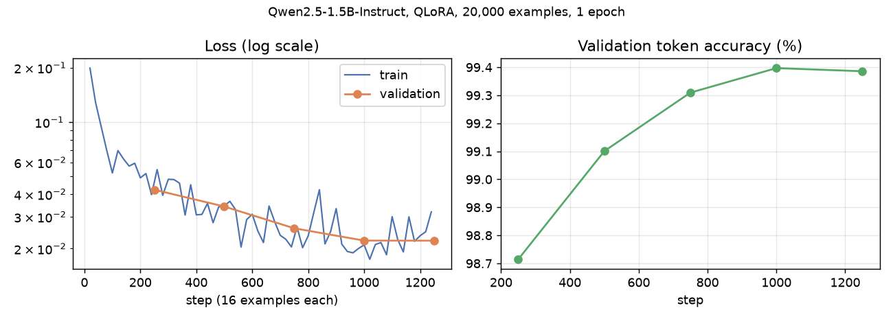

# off-ingredient-linker

A small fine-tuned LLM that proposes a fix for the ingredient names the Open Food Facts parser does not recognize.

## The problem

The OFF ingredient parser links each piece of an ingredient list to the taxonomy by **exact match**, in the declared language. Whatever does not match stays "unknown": no allergens, no vegan/vegetarian status, no NOVA contribution. In the current export, that is **1.85 million distinct unknown names**. Today they are fixed by hand: volunteers add synonyms or translations to the taxonomy, create entries, or ignore the noise.

For each unknown name, the model proposes one of four decisions:

| Decision | Example |
|---|---|
| `{"type": "existing", "id": ...}`: it is an existing entry (other language, typo, OCR error, plural) | `paprikapulver` → `en:paprika-powder` |
| `{"type": "new", "parent": ...}`: a real ingredient missing from the taxonomy, with its closest parent | `triple filtered purified water` → new, parent `en:filtered-water` |
| `{"type": "not_ingredient"}`: nutrition facts, addresses, fragments | `energy kj energy kcal fat` |
| `{"type": "structure"}`: list phrases | `tocopherols added to maintain freshness` |

## How it works

1. **Retrieval.** A multilingual embedding model (`multilingual-e5-small`) finds the 10 closest taxonomy entries, whatever their language, with a similarity score.
2. **Decision.** Qwen2.5-1.5B-Instruct, fine-tuned with QLoRA, reads the name, the declared language, the surrounding list and the 10 candidates, then answers in JSON.

**Training data** (37,214 examples, built automatically by `build_dataset.py`; a rebuild gives a few more or fewer "new" examples):

| Source | Examples | Answer |
|---|---:|---|
| Links actually made by the OFF parser | 12,000 | existing |
| Taxonomy names damaged on purpose (OCR errors, wrong declared language, percentages) | 12,000 | existing |
| Taxonomy leaves hidden from the index | 2,214 | new + parent |
| Unknown names picked by rules (nutrition tables, URLs, fragments…) | 9,000 | not_ingredient |
| List phrases ("may contain", "contains 2% or less of"…) | 2,000 | structure |

**Test set** (`test_gold.jsonl`): 300 real unknown names, each present in at least 10 products. They are sampled by language from the export and annotated by hand; 293 are scored, and 7 uncertain ones are left out. None of them appears in the training data.

**Training:** 20,000 examples, 1 epoch, LoRA rank 16 on every linear layer (18.5 M trainable parameters, 1.2 % of the model), base model in 4 bits. It takes about 3 h on an 8 GB laptop GPU (RTX 4060).



## Results

*Strict* means the right decision **and** the right entry (or the right parent for a new ingredient).

| Approach | Right decision | Strict | Allergens recall (35 cases) | False allergen alerts |
|---|---:|---:|---:|---:|
| Current OFF parser (by construction: these are its failures) | 0 % | 0 % | 0 % | 0 |
| Best non-LLM baseline: exact match in any language > fuzzy match > retrieval | 70.6 % | 62.5 % | 68.6 % | 11 |
| Qwen2.5-1.5B-Instruct, not fine-tuned | 37.5 % | 33.1 % | 40.0 % | 1 |
| **Qwen2.5-1.5B-Instruct, fine-tuned** | **78.2 %** | **68.6 %** | **91.4 %** | **4** |

The 35 test names that should carry an allergen appear in 811 products. The model finds the right allergens for 32 of them, which cover **775 products**.

Strict score by cause:

| Why OFF did not recognize it | Cases | Fine-tuned model |
|---|---:|---:|
| Right name, wrong declared language | 69 | 98.6 % |
| Variant, typo, OCR error | 123 | 55.3 % |
| Not an ingredient | 79 | 75.9 % |
| List phrase | 6 | 50.0 % |
| Missing from the taxonomy (new) | 16 | 12.5 % |

Qwen2.5-3B, fine-tuned the same way, reached 70.0 % strict (+4 cases), for three times the training time. That gain is not worth the extra cost.

**Limits.** New ingredients remain the weak spot. With 68.6 % strict accuracy, the model's output should be used as **suggestions reviewed by a contributor**, never as direct edits.

## Usage

```bash
pip install -r requirements.txt
python build_dataset.py     # downloads taxonomies + export (~4 GB), builds data/train.jsonl, valid.jsonl, test_prompts.jsonl
python train.py             # QLoRA fine-tuning -> models/adapter/ + predictions on the test set
python infer.py "paprikapulver" "glyserol" --lang en
```

The trained adapter is on the Hugging Face Hub, so no training is needed: `python infer.py "glyserol" --adapter Nafety/off-ingredient-linker`. On first run it downloads the taxonomies and builds the index (a few minutes on CPU), without the product export.

```json
{"name": "glyserol", "lang": "en", "type": "existing", "id": "en:e422", "entry": "en:e422 — E422 | Glycerol | Gliserol", "allergens": []}
```

| File | Role |
|---|---|
| `build_dataset.py` | taxonomy parsing, extraction from the export, embedding index, training examples |
| `train.py` | QLoRA fine-tuning and test-set predictions |
| `infer.py` | linking new names with the trained adapter |
| `test_gold.jsonl` | the 300 annotated test names |
